

  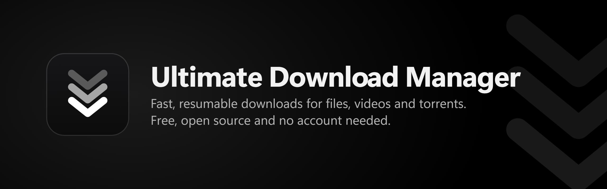

  
  
  
  

<h3 align="center">
  <a href="https://github.com/D3MON999/Ultimate-Download-Manager/releases/latest">Download Ultimate Download Manager</a>
</h3>

  A fast download manager for Windows that takes over your browser's downloads, videos and torrents, and finishes them even after a crash or a lost connection.

 

  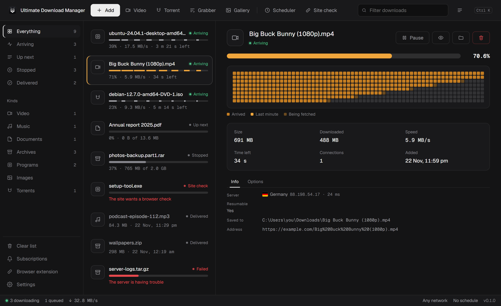

## Why Ultimate Download Manager

- **Fast where browsers are slow.** Every file comes in over many connections at once, and when a site slows each connection down, the app keeps adding connections while they still help.
- **Nothing starts over.** Pause, close the app, lose your Wi-Fi or restart Windows: downloads carry on from where they stopped.
- **One app for everything.** Files, videos and music from YouTube and 1,800+ other sites, torrents, file hosts and image galleries, all in one list.
- **Your browser, handled.** The extension sends your downloads to the app with the cookies they need, so files behind a sign-in download too.
- **Nothing extra.** There are no accounts, ads or telemetry, and it's free and open source.

## What it does

<table>
  <tr>
    <td width="50%">
      <h3>Videos and music</h3>
      Pick a quality and start at once. Audio only, subtitles, chapters, parts of a video and whole playlists are a click away.
    </td>
    <td width="50%">
      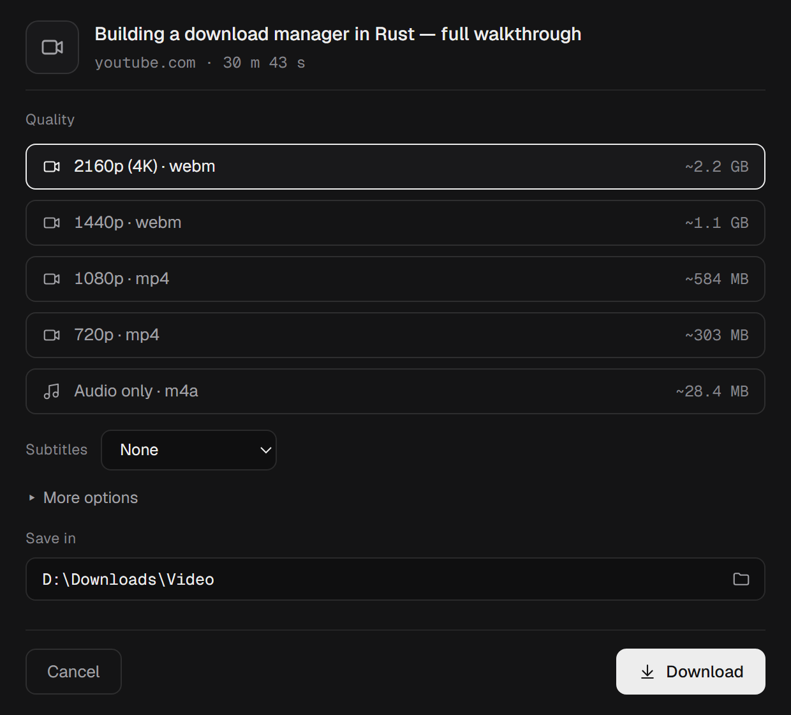
    </td>
  </tr>
  <tr>
    <td width="50%">
      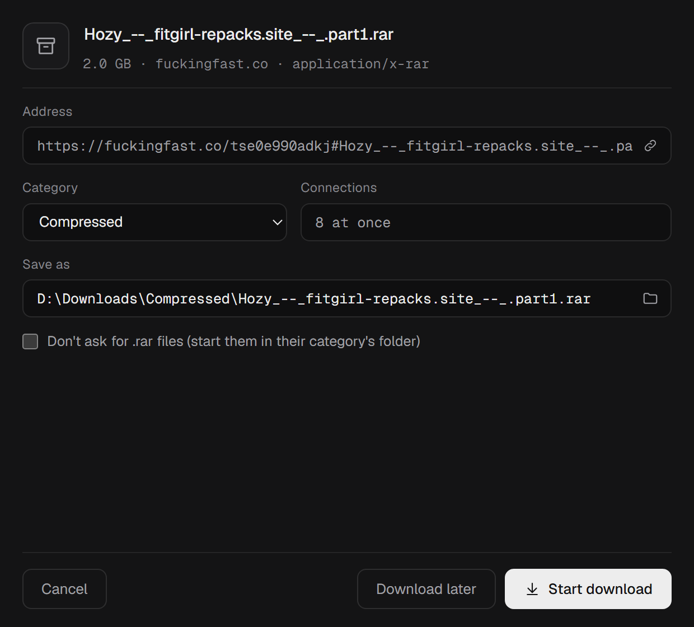
    </td>
    <td width="50%">
      <h3>From your browser</h3>
      Click a download as usual and a small window asks where to save it, with the file's size and type. A download button appears over videos too.
    </td>
  </tr>
  <tr>
    <td width="50%">
      <h3>Progress you can read</h3>
      Watch each part of the file arrive, with the speed, the time left and where the server is.
    </td>
    <td width="50%">
      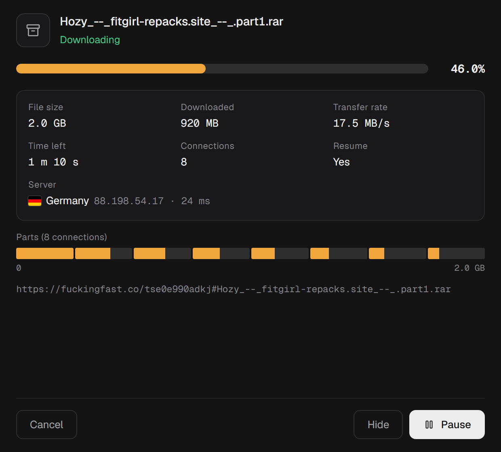
    </td>
  </tr>
  <tr>
    <td width="50%">
      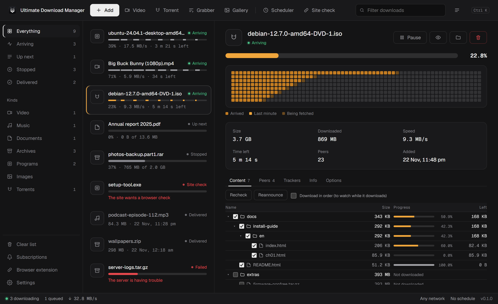
    </td>
    <td width="50%">
      <h3>Torrents</h3>
      Open magnet links and .torrent files, choose which files you want, and see every piece and peer.
    </td>
  </tr>
  <tr>
    <td width="50%">
      <h3>Queues and schedules</h3>
      Keep a queue for tonight and one for right now, each with its own number of downloads at once and its own hours.
    </td>
    <td width="50%">
      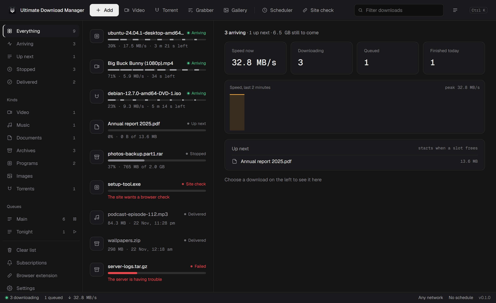
    </td>
  </tr>
</table>

Paste a page full of links into the link grabber and pick what you want: split archives go into one folder and unpack once the last part arrives. File hosts, debrid accounts, image galleries, channel subscriptions, a phone remote and Click'n'Load are all in the app too.

## Safe by design

  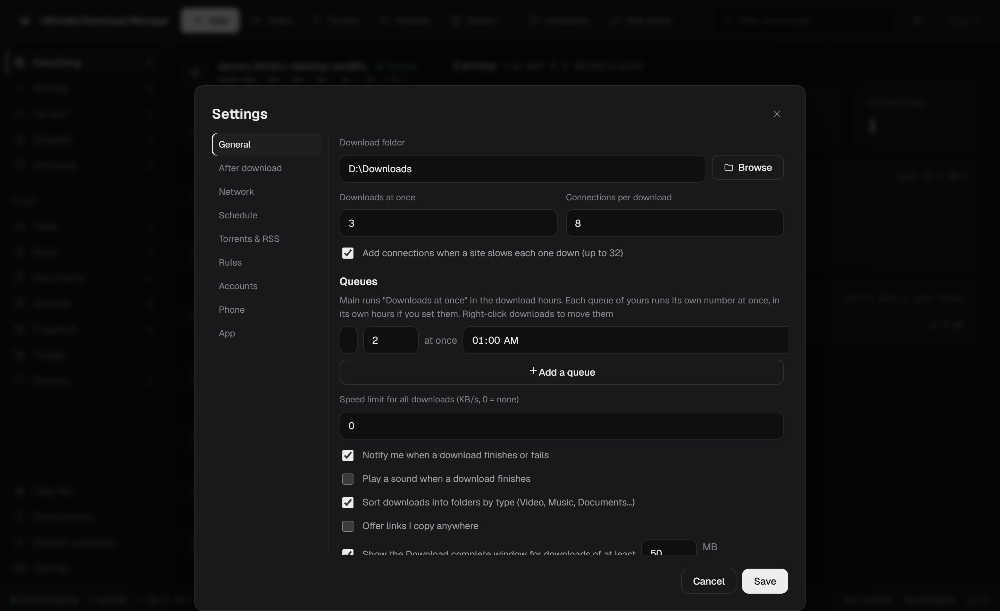

- **No tracking.** The extension talks only to the app on your computer, and the app has no telemetry: it only connects to the sites you download from.
- **Your sign-ins stay private.** Cookies for a download are kept in memory only, and saved sign-ins and account keys are encrypted by Windows.
- **Safe unpacking.** Archives can't put files outside their folder, and oversized "archive bombs" are stopped.
- **Checked files.** Downloads can be checked against their checksum, and optionally scanned by Microsoft Defender.
- **VPN only, if you want.** Tie downloads to your VPN, and they stop instead of going around it when it drops.
- **Crash reports stay with you.** If the app ever closes unexpectedly, a report is saved on your PC, and nothing is sent.

## Make it yours

Choose from three themes, or match your Windows light or dark mode, and switch between the list and table layouts.

<table>
  <tr>
    <td>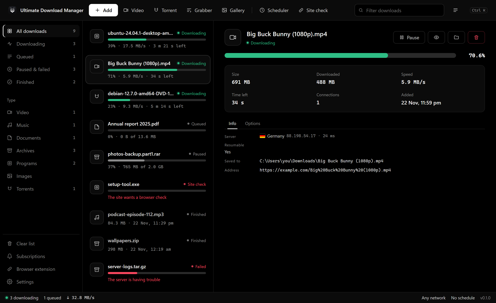
Obsidian
</td>
    <td>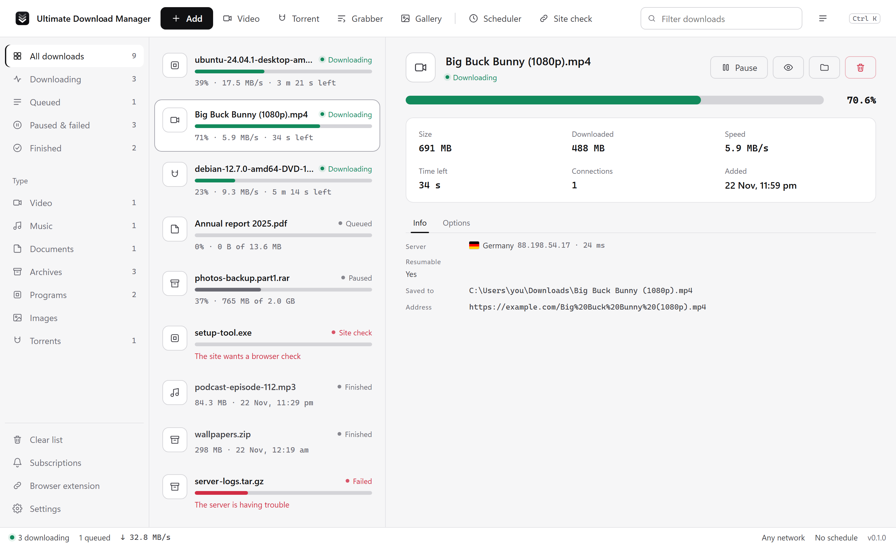
Light
</td>
  </tr>
  <tr>
    <td>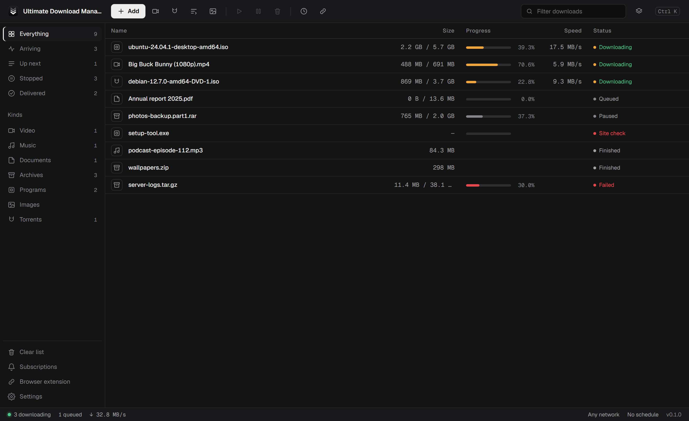
Table layout
</td>
    <td>
Dock
</td>
  </tr>
</table>

Dock, the graphite theme shown at the top, is the default.

## Install

1. Download `UltimateDownloadManager-Setup` from the [latest release](https://github.com/D3MON999/Ultimate-Download-Manager/releases/latest).
2. Run it. Windows will show an unknown publisher warning because the app has no paid certificate, so choose **More info**, then **Run anyway**.
3. Open Ultimate Download Manager and add the browser extension when it offers, so your downloads come to the app.

You'll need 64-bit Windows 10 or 11 and the Microsoft Edge WebView2 Runtime, which most PCs already have.

## For developers

How to build Ultimate Download Manager and make a release is in [docs/DEVELOPMENT.md](docs/DEVELOPMENT.md).

## License

Ultimate Download Manager is free software: you can redistribute it and/or modify it under the terms of the GNU General Public License, version 3 or (at your option) any later version. See [LICENSE](LICENSE).

It includes third-party components under their own licences; see [THIRD-PARTY-NOTICES.md](THIRD-PARTY-NOTICES.md). Videos are downloaded with yt-dlp and FFmpeg, which the app fetches from their official releases.

Ultimate Download Manager is an independent project and is not affiliated with or endorsed by any other download manager or company.

Screenshots use sample data.
